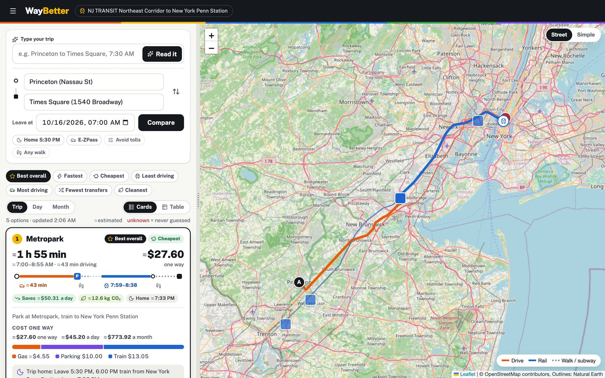
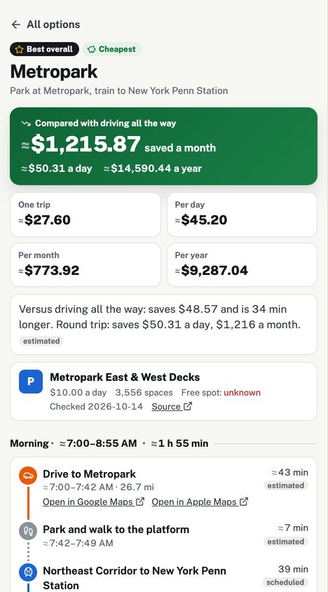

# WayBetter — Park-and-Ride Trip Planner (NYC Metro)

Should you drive all the way into Manhattan, or drive to a train station, park, and ride in?
WayBetter compares both, door to door, on **time and total cost**: gas, tolls, the congestion
toll, parking, and rail fares. It plans the trip home too, so it can show what each choice costs
per day, month and year. Every number says where it came from, and when there is no sourced
number, the app says **unknown** instead of guessing.



**Status (October 2026): working demo** on one corridor, NJ TRANSIT's Northeast Corridor into
New York Penn Station, with real timetables and official toll, fare and parking prices. The
production stack in [PLAN.md](PLAN.md) (OpenTripPlanner, Mapbox, Next.js, iOS) comes next; every
external service already sits behind an interface, so that swap is an adapter change.

## What it does

- **Ranks the options seven ways** (best overall, fastest, cheapest, least / most driving, fewest
  transfers, cleanest). Ranking happens on the server; a badge goes only to an outright winner.
- **Prices the real route.** Tolls come from the roads the drive actually uses, in the right
  direction and at the right time of day (NJ Turnpike peak rates, the Lincoln Tunnel only into
  New York, the congestion toll once a day).
- **Plans the whole commute.** The trip home, the daily total, and monthly and yearly figures,
  using a monthly rail pass when it beats daily tickets.
- **Shows its sources.** ≈ marks an estimate, plain numbers come from a published schedule or
  price, and a Data sources view lists every price file with its source URL and retrieval date.
- **Reads a trip in plain English.** A local AI model (Ollama, `qwen3:8b`) fills a validated form,
  code checks it against your words, and nothing is searched until you confirm. If the model is
  down, a rules parser takes over.
- **Filters that explain themselves.** Avoid tolls and a walking limit hide options, and the page
  lists each hidden option with the reason.
- **CO₂ per option** from EPA factors, your own mpg and gas price, and hand-off links to Google
  Maps or Apple Maps for the drive.



## How it works

```
Browser (one static page) ──POST /api/v1/trip/search──▶ FastAPI
                                                       ├─ TripSearchService: filter, rank, badge, explain
                                                       ├─ cost engine ◀── data/*.yaml (sourced, dated prices)
                                                       ├─ DrivingProvider ── OSRM, cached (→ Mapbox)
                                                       ├─ TransitProvider ── NJ TRANSIT GTFS (→ OpenTripPlanner)
                                                       ├─ GeocodingProvider ── OpenStreetMap Nominatim
                                                       └─ LLMProvider ── Ollama, rules fallback (→ Gemini)
```

- **All logic is server-side.** The page only draws the API's display-ready JSON, so a future
  iPhone app gives the same answers.
- **Contract first.** [docs/api-spec.yaml](docs/api-spec.yaml) is the API contract (v0.8.0); a test
  fails the build if the code and the contract disagree.
- **Regions are data.** Fares, tolls, parking, emissions factors and feeds live in `data/` with
  their source and retrieval date. No prices or agency names in code.
- **The AI never routes or prices.** It parses words into a schema; unknown fields are rejected.

## Run it locally

Needs Python 3.12+, and for plain-English input, [Ollama](https://ollama.com) with `qwen3:8b`.

```bash
make install                 # backend virtualenv + dependencies
make env                     # creates .env; add your NJ TRANSIT developer-portal login
make fetch-feeds             # downloads the GTFS timetables
make warm-cache              # caches the demo driving routes (then it works offline)
backend/.venv/bin/uvicorn app.main:app --app-dir backend --port 8000 --env-file .env
```

Open http://localhost:8000. API docs are at `/api/v1/docs`. [DEMO.md](DEMO.md) has the full demo
script, expected results and known limitations.

## Quality

- 304 automated tests: cost math, toll direction and time-of-day rules, every sort, filter and
  badge tie rule, unknown handling, the AI parser's guardrails, and contract parity. `make check`
  runs ruff, mypy strict and pytest; CI runs lint and tests on every push to main and every pull
  request.
- Accessibility: keyboard-operable, screen-reader labels on every number, and an axe-core
  WCAG 2.1 AA scan of the list, detail and table views with no violations.
- Verified end to end against the real NJ TRANSIT feed, including a run with all network access
  blocked.

## Limitations

One corridor and four station lots; drive times are free-flow (no live traffic); timetables are
scheduled, not real-time; lot availability isn't modeled; "arrive by" isn't planned yet. See
[DEMO.md §5](DEMO.md) for the full list.

## Documentation map

| File | What it is |
|---|---|
| [PLAN.md](PLAN.md) | Approved implementation plan for the launch build |
| [REQUIREMENTS.md](REQUIREMENTS.md) | Numbered requirements (F-xx / N-xx) cited in commits and tests |
| [DECISIONS.md](DECISIONS.md) | Locked decisions with rationale |
| [PROGRESS.md](PROGRESS.md) | Status board and append-only work log |
| [DEMO.md](DEMO.md) | How to run and present the demo, expected results, limitations |
| [docs/api-spec.yaml](docs/api-spec.yaml) | The API contract |
| [multimodal_park_and_ride_prd.md](multimodal_park_and_ride_prd.md) | Long-term product vision |
| [CLAUDE.md](CLAUDE.md) | Standing rules for the AI agents that build it |

Solo portfolio project by Umair Siddiqui, built with AI agents doing the implementation under
human direction and review.
